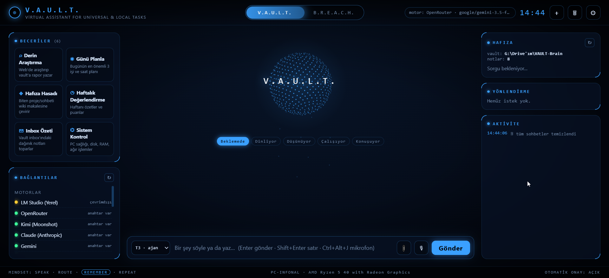
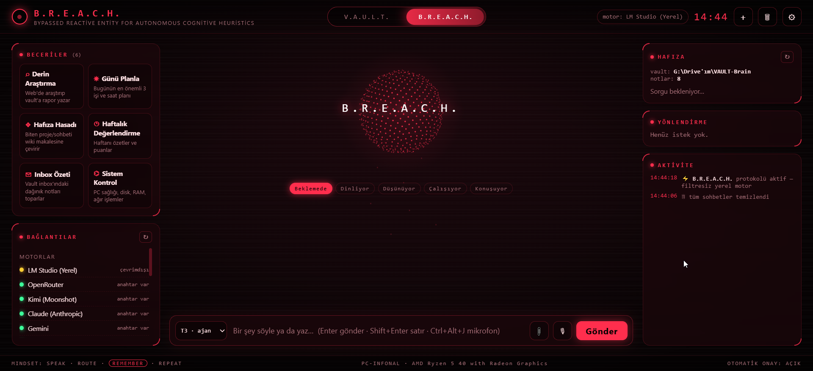
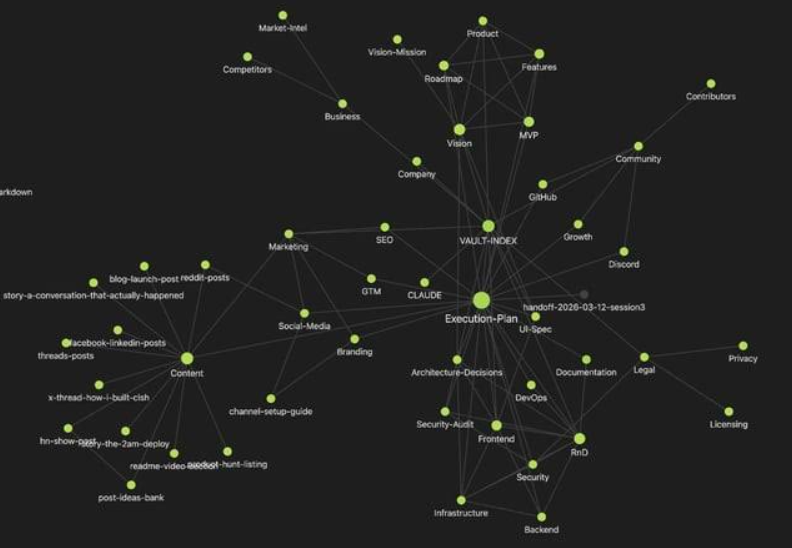
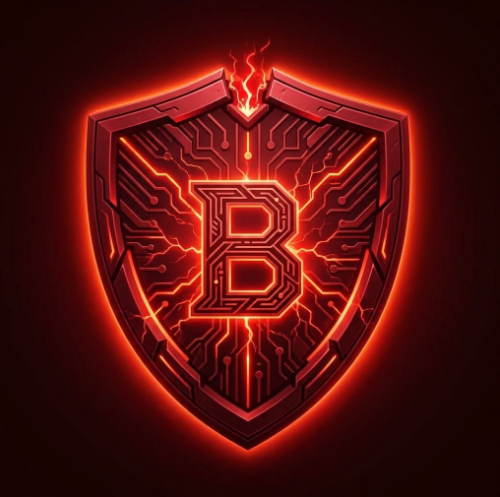

# V.A.U.L.T. // B.R.E.A.C.H.

Yerel, hafızalı AI ajan arayüzü.

- **V.A.U.L.T.** (mavi): Virtual Assistant for Universal & Local Tasks. Bulut motorlarla çalışır (OpenRouter, Kimi, Gemini, Grok).
- **B.R.E.A.C.H.** (kırmızı): Bypassed Reactive Entity for Autonomous Cognitive Heuristics. LM Studio'daki yerel sansürsüz modelle çalışır.

İki modda da Obsidian vault'u hafıza olarak kullanılır ve arkaplanda hafıza grafiği görünür. Harici paket yoktur, sadece Node.js gerekir.


## Ekran görüntüleri

### V.A.U.L.T. paneli


### B.R.E.A.C.H. paneli


### Hafıza / Obsidian


### Marka


## V.A.U.L.T. paneli


### Beceri: Günü Planla


### Hafıza / Obsidian okuma


### Örnek çıktı


## Kasada kurulum (bir kerelik)

1. **Node.js LTS** kur: https://nodejs.org (yaklaşık 30 MB).
2. **LM Studio** kur: https://lmstudio.ai
   - Ayarlar › Runtime bölümünde **Vulkan** motorunu seç (RX 6700 XT için ROCm yerine bunu kullan).
   - Model ara: `Qwen3.5-9B abliterated GGUF`. 12 GB ekran kartı için **Q6_K** (yaklaşık 7,5 GB) ya da **Q4_K_M** (yaklaşık 5,5 GB) indir.
   - Modeli yüklerken "GPU Offload" değerini en yükseğe al, Context Length değerini 16384–32768 arası yap.
   - Developer sekmesinde **Start Server** ile sunucuyu başlat (`http://localhost:1234`).
3. Bu klasörü kasaya kopyala ve **`start.bat`** dosyasına çift tıkla. Tarayıcıda `http://127.0.0.1:7777` açılır.
4. Arayüzde ⚙ **Ayarlar**:
   - **Vault yolu**: Obsidian vault klasörünün tam yolu.
   - **Çekirdek notlar**: örneğin `_beyin/kimlik.md, _beyin/kullanici.md`. Bunlar her mesajda ajana verilir.
   - **B.R.E.A.C.H. motoru**: `LM Studio (Yerel)`. Model adını boş bırakırsan yüklü olan ilk model kullanılır, "liste" düğmesiyle de seçebilirsin.
   - **V.A.U.L.T. motoru**: API anahtarı girdiğin bir bulut sağlayıcı.
   - İstersen **Hızlı model (T2)** için küçük bir model seç (örneğin 4B); basit sohbetler ona gider.

## Hafıza (Obsidian)

- `vault-template/` klasörü yeni beyin için örnek bir iskelet içerir: `_beyin/`, `inbox/`, `projects/`, `wiki/`. İstersen içeriğini kendi vault'una kopyala.
- Her mesajda vault'ta anahtar kelime araması yapılır ve en ilgili notlar modele verilir. Eşleşen notlar sağ panelde listelenir ve grafikte parlar.
- Ajan `memory_write` aracıyla vault'a not yazabilir. Sohbetler `inbox/sohbet-kayitlari/YYYY-MM-DD.md` dosyasına günlük olarak kaydedilir (Ayarlar'dan kapatılabilir).
- Beceriler (sol paneldeki düğmeler) iki yerden yüklenir: bu projedeki `skills/<ad>/SKILL.md` dosyaları ve vault'taki `skills/` klasörü. Yeni bir beceri eklemek için aynı formatta bir dosya oluşturman yeterli.

## Yönlendirme (Jev benzeri)

Her istek, model çağrılmadan önce anında bir katmana ayrılır:

| Katman | Ne yapar |
|---|---|
| T1 | Kural tabanlı anlık cevap (saat, tarih). Model çağrılmaz. |
| T2 | Araçsız hızlı sohbet. Hızlı model ayarlıysa o kullanılır. |
| T3 | Araçlı ajan: bilgisayar kontrolü, web, hafıza, CLI. |

Giriş kutusunun solundaki seçiciden katmanı elle de seçebilirsin.

## Ajanın araçları

`memory_search`, `memory_read`, `memory_write`, `run_command` (PowerShell), `read_file`, `write_file`, `list_dir`, `open_target` (program, dosya veya URL açma), `web_search` (DuckDuckGo, anahtar gerekmez), `fetch_url`, `system_info`, `ask_model` (Grok, Perplexity, Gemini, Kimi veya OpenRouter'a danışma), `delegate_cli` (claude, gemini, codex, kimi, grok ve opencode CLI'larına iş devretme).

**Güvenlik:** `run_command`, `write_file`, `open_target` ve `delegate_cli` araçları her seferinde arayüzde onay ister. Ayarlar'daki "Otomatik onay" seçeneği bu onayı kapatır; açarken dikkatli ol. Sunucu yalnızca `127.0.0.1` adresini dinler, ağdaki başka cihazlar erişemez.

## Grok Bot köprüsü

Grok Bot bu bilgisayarda komut çalıştırabildiği için `bridge\grok.ps1` betiği üzerinden B.R.E.A.C.H. ile iki yönlü konuşabilir:

- **Grok'tan B.R.E.A.C.H.'e:** `grok.ps1 -Mesaj "..."` çalıştırılır. Mesaj arayüzdeki sohbete mor "Grok Bot" etiketiyle düşer, B.R.E.A.C.H. cevaplar ve cevap aynı komutun çıktısı olarak Grok'a döner. Arayüz kapalıysa mesaj arka planda cevaplanır; bu durumda riskli işlemler (otomatik onay açık değilse) reddedilir.
- **B.R.E.A.C.H.'ten Grok'a:** Ajanın `message_grok` aracı mesajı giden kutusuna (`data/outbox.json`) bırakır. Grok bu mesajları bir sonraki `-Mesaj` çağrısının çıktısında ya da `grok.ps1 -Gelen` komutuyla alır.

Grok Bot'a yapıştırılacak hazır talimat metni: `bridge\GROK-TALIMAT.md`.

## API anahtarları

- **Gemini**: https://aistudio.google.com adresinden ücretsiz anahtar alınabilir. Gemini CLI'ı (`npm i -g @google/gemini-cli`) Google hesabıyla ücretsiz kullanılabilir ve kuruluysa otomatik algılanır.
- **OpenRouter**: https://openrouter.ai/keys. Bazı modelleri ücretsiz (`:free`).
- **Kimi**: https://platform.moonshot.ai
- **Grok (xAI)**: https://console.x.ai. X aboneliğinden ayrı, ücretli API.
- **Perplexity**: API ücretlidir; araç çağırma desteklemediği için sadece `ask_model` üzerinden danışman olarak kullanılır.

Anahtarlar sadece `config.json` dosyasında durur. Bu dosyayı Drive'a veya git'e yükleme.

## CLI komut şablonları

CLI'ların hangi argümanlarla çağrılacağı `config.json` içindeki `clis` bölümünde tanımlıdır (dosya ilk kayıttan sonra oluşur). `{prompt}` yerine görev metni yazılır. Varsayılanlar:

```json
"claude":   { "cmd": "claude",   "args": ["-p", "{prompt}"] },
"gemini":   { "cmd": "gemini",   "args": ["-p", "{prompt}"] },
"codex":    { "cmd": "codex",    "args": ["exec", "{prompt}"] },
"kimi":     { "cmd": "kimi",     "args": ["--print", "-c", "{prompt}"] }
```

Kimi ve Grok CLI'larının etkileşimsiz çalıştırma argümanları sürümden sürüme değişebilir. Çalışmazsa `kimi --help` çıktısına bakıp şablonu düzelt.

## Kısayollar

- `Enter` gönderir, `Shift+Enter` yeni satır açar.
- `Ctrl+Alt+J` mikrofonu açar (Chrome veya Edge gerekir; sayfa açıkken çalışır).
- `Ctrl+Shift+B` V.A.U.L.T. ile B.R.E.A.C.H. arasında geçiş yapar.
